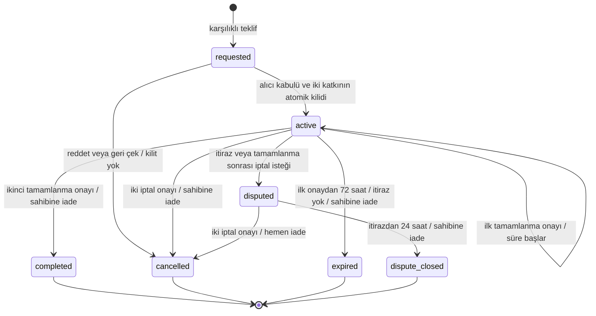

# Karşılıklı takas modeli ve eski kayıt geçişi

Bu tasarım [YAYIN 04](../gorevler/04.md) kapsamındadır. Yeni v2 oturumlar iki kişinin de hem öğrettiği hem öğrendiği anlaşmalardır. Eski v1 kayıtların alan adlarını değiştirerek v2 kabul etmek yasaktır; eski bakiyeler korunur.

## Örnek v2 kayıt

Aşağıdaki kimlikler ve tutarlar test verisidir; canlı kaynak veya kullanıcı bilgisi değildir. A Python öğretir, gitar öğrenir. B gitar öğretir, Python öğrenir. B'nin gitar seviyesi 6 olduğu için A 60; A'nın Python seviyesi 4 olduğu için B 40 token kilitler.

```json
{
  "id": "ornek-takas",
  "matchId": "ornek-takas",
  "schemaVersion": 2,
  "requesterId": "a",
  "receiverId": "b",
  "participants": ["a", "b"],
  "teachSkillIds": {"a": "python", "b": "gitar"},
  "learnSkillIds": {"a": "gitar", "b": "python"},
  "taughtNames": {"a": "Python", "b": "Gitar"},
  "levels": {"a": 4, "b": 6},
  "deposits": {"a": 60, "b": 40},
  "status": "active",
  "funded": true,
  "completionVotes": [],
  "cancellationVotes": [],
  "completionRequestedAt": null,
  "remindedAt": null,
  "disputedBy": null,
  "disputeReason": "",
  "settledAt": null
}
```

Bu örnek temel alanları gösterir; doğrudan yazılabilir tam bir oluşturma isteği değildir. `participantNames`, `skill`, `credits`, sunucu `createdAt`/`updatedAt` alanları ve aynı işlemde eşleşme/sohbet belgeleri de oluşturulur. Teklif/kabul rolleri `requesterId`/`receiverId` alanlarıdır; kalıcı öğretmen/öğrenci rolleri değildir. Eski callable kabulünü engellemek için eşleşme belgesinde v2 teklif rolleri `initiatorId`/`recipientId` olarak tutulur.

## Durumlar



`dispute_closed` son durumu PR #45 kapsamındadır; bu tasarım onun main'e birleştiğini varsaymaz. Aktif fakat hiç tamamlanma onayı olmayan oturum için 72 saatlik saat başlamaz. İptal görüşmesi, tamamlama sonrası itiraz ve sessizlik aynı durum değildir.

## Değişmezler ve bağımlılıklar

- Teklifte beceriler, seviyeler ve kişi bazlı katkılar sabitlenir. Değişen şartlar yeni teklif gerektirir. Kabul iki cüzdanı tek transaction içinde okur/yazar; bir bakiye yetersizse ikisi de değişmez.
- Başarıda veya çözümde katkı aynı sahibine döner. Yeni token üretilmez; kişi A'nın katkısı B'ye ödenmez. Terminal oturum ve `settledAt` tekrar iadeyi engelleyen kayıttır.
- Yeni oturumda `teacherId`/`studentId` bulunmaz. Eski Dart modelindeki bu alanlar yalnızca eski kayıt okuma uyumluluğu içindir. Eski mali callable'lar v2'yi işleyemez.
- Firestore erişim kuralları kişi bazlı cüzdan, iki beceri ve onayları doğrular. Zamanlayıcı kuyruğuna istemci yazamaz; sunucu işlemi de güncel oturumu transaction ile tekrar okur.
- Bildirim ve sohbet aynı terminal sonucu izler. `completed` dışındaki kapanışlar öğrettim/öğrendim sayacına girmez. V2 için eski `escrows` belgesi üretilmez; hesabı silme kontrolü `lockedCredits` değerini de korumalıdır.
- V2 temel sorguları mevcut katılımcı alanını kullanır. Zamanlayıcı kuyruğu `dueAt` üzerinde tek alan sorgusudur. Gerçek sorguların indeks kontrolü YAYIN 09'un ayrı kabulüdür.

## Eski v1 kayıtlar için güvenli geçiş planı

Bu plan bir bakiye taşıma komutunu kendiliğinden çalıştırmaz. V1 kayıtlar mevcut uygulamada okunur; yeni mali eylemler eski kayda uygulanmaz.

1. Yetkili ortamda salt okunur v1 oturum, eski escrow ve ilgili cüzdanların mutabakatını çıkar. Kullanıcı başına toplam kilitli katkı, her kilidin sahibi ve eski mali durum kayıtları eşleştirilir. Çakışan/eksik kayıtlar otomasyona alınmaz. Kullanıcı verisi raporu kamuya açık repoya konmaz.
2. Henüz fonlanmamış eski teklifleri kullanıcıya yeni karşılıklı teklif oluşturma yolu sunarak sonlandır. Yeni karşılıklı teklifin iki yönü yeniden doğrulanır. Eski tutar v2 katkısı gibi kopyalanmaz.
3. Fonlanmış v1 oturum için otomatik rol çevirisi yapma. Sahiplik ve mevcut eski sözleşme doğrulandıktan sonra kullanıcıların onayladığı eski çözümü uygula veya açık ürün kararıyla kontrollü iadeyi planla. Bu işlem için ayrı inceleme ve onay gerekir; mevcut UI'dan geçiş yapılmış gibi sunulmaz.
4. Uygulama öncesi ilgili kayıtların erişimi sınırlı yedeğini al. Sunucu işlemi özgün oturum/escrow durumunu ve bütün cüzdanları yeniden okur. Tek terminal durumu, kişi bazlı makbuz ve değişmez bir geçiş kimliği ile atomik yazılır. Tekrar deneme aynı makbuza denk gelirse no-op olur. Böyle bir v1 geçiş çalıştırıcısı henüz uygulanmadı; geliştirilmeden gerçek bakiye taşınmaz.
5. Her işlemden önce/sonra kullanılabilir + kilitli toplamı ve kalan kilitlerin bire bir sahipliğini karşılaştır. İade sonrası negatif bakiye veya kaynağı bulunamayan kilit oluşursa geçiş durur. Kısmi işlem başarılı sayılmaz.

## Geri dönüş planı

Şema sürümü, eski kayıtlar ve ödül makbuzları korunur. V2'nin devreye alınması eski cüzdanları yeniden hesaplamaz. Sorunlu sürümde yeni teklif kabulü durdurulup inceleme yapılır; terminal iadeler geri çevrilmez ve cüzdanlar eski yedekten körlemesine yüklenmez. İade edilmiş tutarı yeniden kilitlemek veya eski oturumu aktif yapmak çift işleme yol açabileceğinden yasaktır. Önceki arayüze dönmek gerekiyorsa v2 kaydı eski tek yönlü mali uçlara yönlendirmek yerine salt okunur desteklenir. Bu durdurma/uyumluluk adımları operasyon planıdır; yayın bayrağı veya geçiş yürütücüsü hazır olarak iddia edilmez.

## Negatif test kanıtı

`functions/mutual_exchange_emulator.test.js` iki yönlü beceri şartını, tek taraflı/negatif/yetersiz bakiye girişimlerini, yetkisiz erişimi, çift kabul/iade korumasını ve eski callable'ların v2'yi işleyememesini kapsar. `verification_emulator.test.js` eski mali akışın testlerini ayrıca korur. V1 geçiş yürütücüsü geliştirildiğinde aynı eski escrow üzerinde tekrar çalışma, işlem ortasında hata, eşzamanlı eski istemci, eksik cüzdan ve toplam korunumu testleri de zorunludur. Mevcut v2 testleri yapılmamış bir v1 geçişinin kanıtı sayılmaz.
